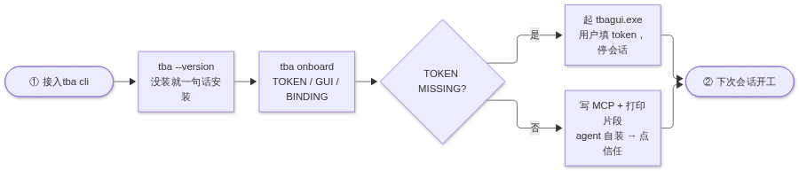
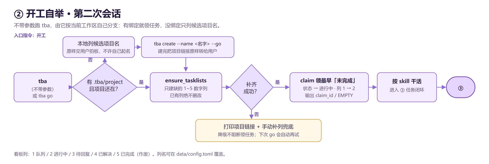
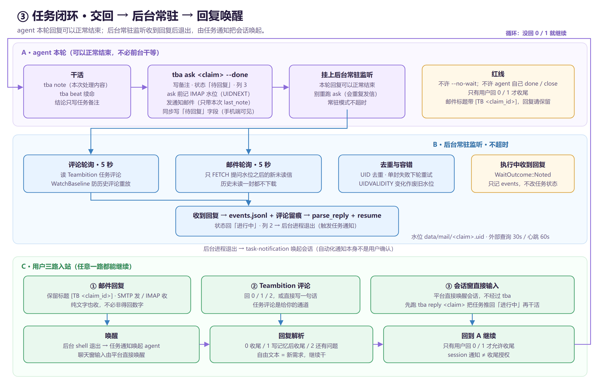
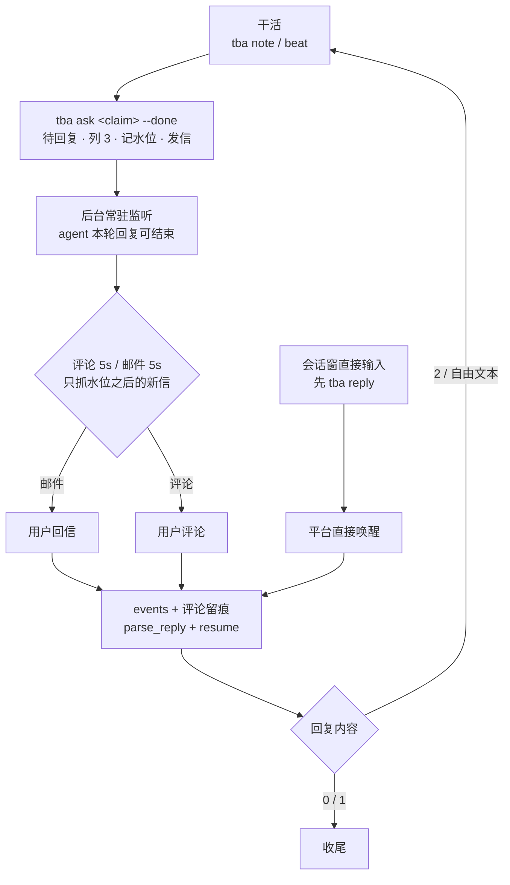

# TBA

   

**Teambition Agent Orchestrator** —— 让 AI agent 在 Teambition 上排队领任务、把过程写进任务备注，交回后由**后台常驻监听**等你在邮件 / 评论 / 会话窗回复，回复一到自动唤起会话继续，不用前台干等 10 分钟。

一个 Rust 二进制，三种用法：CLI（`tba`）、MCP server（`tba serve`）、桌面窗口（`tba ui`）。数据放在 exe 同目录的 `data/`，同一台设备上所有 agent 共享。

- 仓库：<https://github.com/Rei1mu/teambition-agent-orchestrator>
- 最新安装包：[Releases](https://github.com/Rei1mu/teambition-agent-orchestrator/releases)
- 完整流程文字版：[docs/流程图.md](docs/流程图.md) · 图片源文件：[docs/*.svg](docs/flow-loop.svg)

---

## 目录

| | |
|---|---|
| [为什么需要它](#为什么需要它) · [核心特性](#核心特性) | [快速开始](#快速开始) · [安装](#安装) |
| [工作流程（图片 + 文字版）](#工作流程图片--文字版) | [回复协议](#回复协议) · [命令速查](#命令速查) |
| [状态模型](#状态模型) · [配置](#配置) | [邮件通道为什么快](#邮件通道为什么快) |
| [开发与发版](#开发与发版) · [排查](#排查) | [文档索引](#文档索引) · [许可](#许可) |

---

## 为什么需要它

1. **多设备、不同 agent 无缝续作**：项目背景（skill）和进展（记忆）放在 Teambition 与本地 `data/`，不绑死在某台机器或某个 agent 上。换设备挂上同一个项目就能接着干。
2. **把 token 花在干活上**：`tba prompt` 只打包该项目启用的 skill、共享记忆和领到的任务，agent 不必每次通读仓库、翻聊天记录重建背景。
3. **关键流程不靠 agent 自觉**：易错、依赖环境、有严格顺序的动作（重载 exe、补看板列、交回并挂监听）收进命令里，而不是留在文字约定里。agent 只负责调用。
4. **状态可度量**：五个固定阶段 + 五个看板列，谁在做什么、积压多少、完成多少，看板上一眼可查。

## 核心特性

- **两次会话分工**：第一次做设备接入（装 tba / 挂 MCP / 用户自己填 token），第二次才开工领任务；接入会话不碰任务队列。
- **零上下文开工**：在项目目录里敲 `tba`，它按当前工作区自己决定领任务还是列候选项目名。
- **后台常驻监听**：`tba ask` 交回后挂后台，agent 本轮回复可以正常结束；评论 / 邮件轮询都是 5 秒，收到回复由任务通知唤起会话。
- **三路入站**：邮件回复、Teambition 评论、会话窗直接输入，任意一路都能继续；执行中收到的回复也会落盘留痕，不丢。
- **只抓新信**：按提问时刻的 IMAP `UIDNEXT` 水位过滤，历史未读信一封都不下载，实测端到端从 31~41 秒降到秒级。
- **手机端看得见待回复内容**：Teambition 手机端不渲染内置备注，`ask` 会把与邮件逐字相同的正文同步写进任务文本字段「待回复」；收到回复或收尾自动清空。
- **离线直连 / 共享记忆 / skill 库 / MCP / 打包发版**：不需要 Teambition 时也能用 `tba go -off` 只在本机跑。

---

## 快速开始

**设备接入和干活分两次会话。** 第一次每台设备做一次，之后每次开工直接进第二次。

| 会话 | 触发语 | 做什么 | 不做什么 |
|---|---|---|---|
| ① 设备接入 | 「接入tba cli」 | 装包 → `tba onboard` → 用户填 token → 挂 MCP → 点信任 | 不建项目、不领任务、不跑 `tba go` |
| ② 开工 | 「开工」或 `tba go` | 不带参数跑 `tba`，由它领任务或列候选项目名 | 不自己起项目名 |

**① 装好并接上（PowerShell）：**

```powershell
irm https://raw.githubusercontent.com/Rei1mu/teambition-agent-orchestrator/main/install.ps1 | iex
tba onboard
```

`onboard` 只查本地、不联网、不碰任务队列，打印 `TOKEN / GUI / BINDING` 状态。出现 `TOKEN MISSING` 时窗口会自动打开，**token 由你本人填**（<https://open.teambition.com/user-mcp> 创建），agent 不代填、不改 `data/config.toml`，本次会话到此为止。

**② 挂 MCP：** `tba onboard` 幂等写 WorkBuddy 一家配置；其他 agent 客户端用 `tba mcp` 打印的片段自己合并。装完在连接器管理页对 `tba` 点「信任」，**下一次会话**生效。

**③ 开工：** 新开一个会话，在项目目录里：

```bat
tba
```

有绑定就领任务并输出 `claim_id`（`EMPTY` 表示队列空）；没绑定只列候选项目名，原样交你拍板，选定后跑 `tba create --name "<选定的>" --go`。看板列 1~5 由 tba 自动补齐，补不动才给你项目链接和手动兜底步骤。

---

## 安装

### 安装包（推荐）

从 [Releases](https://github.com/Rei1mu/teambition-agent-orchestrator/releases) 下载 `tba-<版本>-<arch>-setup.exe`：

| 文件 | target | 适用 |
|---|---|---|
| `tba-<版本>-x64-setup.exe` | `x86_64-pc-windows-msvc` | 普通 Windows 10/11 |
| `tba-<版本>-arm64-setup.exe` | `aarch64-pc-windows-msvc` | Windows on ARM（骁龙本） |

### 一句话安装

```powershell
irm https://raw.githubusercontent.com/Rei1mu/teambition-agent-orchestrator/main/install.ps1 | iex
```

脚本下载最新 Release → 静默安装 → 合并写 `~/.workbuddy-ai/mcp.json`（只动 `mcpServers.tba`，不删 `data/`、不覆盖别的 server）。固定版本：先设 `$env:TBA_VERSION = 'v0.2.31'`。脚本写 exe 绝对路径，不依赖 PATH 刷新。

### 从源码构建

```powershell
cargo build --release --locked
```

MSVC 工具链要求与本机构建约定见 [docs/REFERENCE.md](docs/REFERENCE.md)「构建工具链」一节。

### 数据目录

```
<安装目录>/
├─ tba.exe            CLI + MCP server + 窗口
├─ tbagui.exe         窗口启动器（token 缺失时自动打开）
└─ data/
   ├─ config.toml     令牌 / SMTP / IMAP / 轮询参数（不要提交）
   ├─ waits/          常驻监听心跳
   ├─ mail/           提问水位 <claim_id>.uid
   ├─ events.jsonl    监听期间收到的用户回复（只追加）
   └─ projects/       skill / mem 本地缓存
```

---

## 工作流程（图片 + 文字版）

三张图都是仓库里的静态 PNG，任何 Markdown 阅读器都能显示，不依赖 Mermaid 前端。**每张图下面都有纯文字版**；可编辑的矢量源文件是同名的 `.svg`。

### ① 设备接入（每台设备一次）



<details>
<summary>纯文字版（不依赖图片）</summary>

```text
① 接入tba cli（第一次会话，每台设备一次）
  ├─ tba --version
  │    └─ 找不到命令 → PowerShell 跑一句话安装脚本
  ├─ tba onboard   （只查本地 / 不联网 / 不碰任务队列）
  ├─ TOKEN MISSING → 起 tbagui.exe，用户本人填 token
  │                  → 本次会话到此为止，另开会话进 ②
  └─ TOKEN OK      → 幂等写 WorkBuddy MCP + 打印 tba mcp 片段
                     → agent 把片段合并进自己客户端配置
                     → 用户点「信任」→ 下一次会话生效 → ②
```

</details>

### ② 开工自举（第二次会话）



<details>
<summary>纯文字版（不依赖图片）</summary>

```text
② 开工 / tba go
  ├─ 不带参数执行 tba
  ├─ 有 .tba/project 且线上项目还在？
  │    ├─ 否 → 本地列候选项目名 → 原样交用户拍板
  │    │        → tba create --name "<选定的>" --go
  │    └─ 是 → 直接往下
  ├─ ensure_tasklists：只建缺的 1~5 数字列，已有列绝不删改
  │    └─ 补齐失败 → 打印项目链接 + 手动补列兜底，不阻断领任务
  └─ claim：领最早「未完成」→ 状态「进行中」+ 列 2
           输出 claim_id / EMPTY → 进入 ③
```

</details>

### ③ 任务闭环：交回 → 后台常驻 → 回复唤醒



<details>
<summary>纯文字版（不依赖图片）</summary>

```text
③ 任务闭环
  A. agent 本轮（可以正常结束）
     ├─ 干活：tba note（写本次处理内容）、tba beat（长任务续命）
     ├─ 交回：tba ask <claim> --done
     │        写备注 · 状态「待回复」· 列 3
     │        ask 前记 IMAP 水位（UIDNEXT）· 发通知邮件（只带本次处理内容）
     │        同一份正文同步写入文本字段「待回复」（手机端可见）
     └─ 自动挂上后台常驻监听 → 本轮回复可以正常结束
        （别重跑 ask，会重复发信；不许 --no-wait）

  B. 后台常驻监听（tba wait · forever，不超时）
     ├─ 评论轮询 5 秒 / 邮件轮询 5 秒
     ├─ 邮件只 FETCH 提问水位之后的新未读信，历史未读一封都不下载
     ├─ UID 去重、单封失败下轮重试、UIDVALIDITY 变化作废旧水位
     ├─ 执行中收到回复 → WaitOutcome::Noted：只记 events.jsonl，不改任务状态
     └─ 待回复时收到回复 → events + 评论留痕 → parse_reply + resume
                           状态回「进行中」· 列 2 → 后台进程退出

  C. 唤醒与继续
     ├─ 三路入站：邮件 / Teambition 评论 / 会话窗直接输入
     ├─ 后台 shell 退出 → task-notification 唤起会话
     │   （会话窗输入由平台直接唤醒，先跑 tba reply <claim> 推回「进行中」）
     ├─ 回复解析：0 收尾 / 1 写记忆后收尾 / 2 还有问题 / 自由文本 = 新需求
     └─ 回到 A 继续；只有用户回 0 / 1 才允许收尾
```

</details>

<details>
<summary>Mermaid 源码（可复制到支持 Mermaid 的渲染器）</summary>



</details>

> 完整文字版（含状态机、命令、配置项、兜底规则）见 [docs/流程图.md](docs/流程图.md)。
> 图片源文件：[flow-onboard.svg](docs/flow-onboard.svg) · [flow-go.svg](docs/flow-go.svg) · [flow-loop.svg](docs/flow-loop.svg)。

---

## 回复协议

交回时 `tba ask <claim_id> --done` 给出标准三选项，回复会写回 Teambition 评论并触发状态流转：

| 你回 | 含义 | tba 的动作 |
|---|---|---|
| `0` | 可以收尾 | 「已解决」+ 列 4，任务终结 |
| `1` | 先写项目记忆再收尾 | 回「进行中」+ 列 2，写完记忆再 `ask` |
| `2` | 还有问题 | 回「进行中」+ 列 2，agent 自查后再给选项 |
| `3`+ | 自定义选项 | 回「进行中」+ 列 2，按你写的做 |
| 一句话 | 新需求 | 按原文继续，不必非得回数字 |

**三路入站都能继续：**

| 通道 | 怎么走 | 注意 |
|---|---|---|
| 邮件回复 | SMTP 发信 / IMAP 收信，由后台监听 | 保留标题里的 `[TB <claim_id>]`；纯文字也收 |
| Teambition 评论 | 由后台监听 5 秒轮询 | 评论专属用户，agent 只写任务备注 |
| 会话窗直接输入 | 平台直接唤醒会话，不经过 tba | 先跑 `tba reply <claim_id>` 把任务推回「进行中」再干活 |

### 手机端「待回复」字段（每个项目配置一次）

Teambition 手机端任务详情不渲染内置备注 `note`，所以本轮待回复内容另存一份到文本自定义字段「待回复」。`tba ask` 写入与通知邮件**逐字相同**的正文，`tba resume` / 收尾时清空。字段按名称定位，不存在就跳过并打一行警告——邮件和任务备注始终是主通道，字段不会成为单点故障。

字段需要人工建一次并绑到任务类型（**只建不绑，任务详情里不会出现**）。在目标项目里执行：

```bash
# 1. 先看有没有；result 为 [] 才建（也可在网页端项目设置里新建「文本」字段）
tba raw teambition.project.customfield-query --args '{"projectId":"<项目ID>","name":"待回复"}'
tba raw teambition.project.customfield-create --args '{"projectId":"<项目ID>","name":"待回复","type":"text"}'  # 记下返回的 id

# 2. 绑到默认任务类型（sfcId 用 sfc-query 取 type=default 的那条 id）
tba raw teambition.project.sfc-query --args '{"projectId":"<项目ID>"}'
tba raw teambition.project.sfc-field-upsert --args '{"projectId":"<项目ID>","sfcId":"<任务类型ID>","customfieldId":"<字段ID>"}'
```

`text` 字段实测写 4000 字完整回读、不截断；不要用 `customfield-rtf-update`，它会把正文截断到 100 字。

**红线（给 agent）**

- 做完必须 `tba ask --done`，然后让它转后台常驻监听；**不许 `--no-wait`**。
- 不许 agent 自己 `done` / `close`；只有用户回 `0` / `1` 才收尾。
- 别在前台干等 10 分钟；本轮回复可以正常结束，任务通知会唤起会话。
- `task-notification` 是自动化通知，不是用户确认，不能当收尾授权。
- `--once` 只用于老路径单轮等待；常驻模式不因 540 秒超时退出。

---

## 命令速查

| 分组 | 命令 | 作用 |
|---|---|---|
| 接入 | `tba onboard` · `tba mcp` · `tba login --token <...>` | 本地自检 / 打印 MCP 片段 / 登录 |
| 项目 | `tba projects` · `tba create --name <名字> --go` · `tba ensure-project --project <id>` | 列项目 / 接入 / 复用已有项目 |
| 开工 | `tba` · `tba go` · `tba claim` · `tba take <链接>` · `tba start --file <md>` | 领任务 / 接单 / 新建任务 |
| 干活 | `tba note <claim> --file <md>` · `tba beat <claim>` · `tba skill <名字> --project <id>` | 写本次处理内容 / 续命 / 读 skill |
| 交回 | `tba ask <claim> --done` · `tba ask <claim> -q "..."` | 转「待回复」+ 发信 + 挂后台常驻监听 |
| 继续 | `tba reply <claim>` · `tba wait <claim>` · `tba events` | 会话窗直回先 reply / 单独常驻监听 / 看落盘回复 |
| 查看 | `tba status` · `tba inbox` · `tba show <链接>` · `tba doctor` | 台账 / 待回复 / 单任务 / 自检 |
| 邮件 | `tba mail status` · `tba mail test` · `tba mail check` · `tba mail resend <claim>` | 配置 / 发测试信 / 收一次 / 重发通知 |
| 收尾 | `tba done <claim>` · `tba close <claim>` · `tba release <claim> --reason "..."` | 已解决 / 作废 / 退回队列（**仅用户授权后**） |
| 发版 | `tba publish --tag v0.2.31 --watch` | 打 tag → 推 → 等 CI → 列产物 |

> `tba mail check` 是诊断命令：会全量扫未读并把命中的信标记为已读，平时别拿它当常驻链路用。

---

## 状态模型

两个维度：**工作流状态表示「是否在执行」，看板列表示「归属」**。

| 局面 | 状态 | 列 | 球在谁那 |
|---|---|---|---|
| 队列中，没人接 | 未完成 | 1 | — |
| agent 正在干 | 进行中 | 2 | agent |
| agent 等你回复 | **待回复** | 3 | 你 |
| 干完 | 已解决 | 4 | — |
| 作废 | 已完成 | 5 | — |

- 五个阶段：`未完成 → 进行中 → 待回复 → 已解决 → 已完成`；另有两个用途标记 `skill` / `mem`，不占阶段、`claim` 不会领走。
- `待回复` 的 kind 是 `unset` 而不是 `end`——球在你那不等于干完了，否则完成率会虚高。
- 列名默认中文，可在 `data/config.toml` 覆盖；列不存在时只跳过移列、不阻断流程，状态才是硬约束。
- `tba claim` 只领「列 1 + 状态未完成」，全程持文件锁，多会话并发不会抢到同一条。

---

## 配置

`data/config.toml`（装完自动生成，**含令牌和邮箱授权码，不要提交**）。

| 键 | 默认 | 说明 |
|---|---|---|
| `access_token` | — | Teambition User Token，由用户本人在窗口或 `tba login` 里填 |
| `smtp_host` / `smtp_port` | `smtp.qq.com` / `465` | 发信 |
| `smtp_user` / `smtp_pass` | — | 账号 + **授权码**（不是登录密码） |
| `smtp_from` | 空 = 用 `smtp_user` | 也可写 `显示名 <邮箱>` |
| `mail_to` | — | 收件人，多个用逗号 / 分号分隔 |
| `imap_host` / `imap_port` | `imap.qq.com` / `993` | 不配就收不到回信 |
| `mail_on_ask` | `true` | 交回时是否发信 |
| `wait_interval_secs` | `5` | 评论轮询间隔（秒） |
| `mail_poll_secs` | `5` | 邮件轮询间隔（秒） |
| `wait_timeout_secs` | `540` | **仅 `--once` 单轮**最长等待；常驻模式不生效 |
| `wait_auto_ask` | `true` | 仅 `--once` 老路径：没 ask 过就 `wait` 时自动补问 |

下限保护：`wait_timeout_secs ≥ 30`、`wait_interval_secs ≥ 5`、`mail_poll_secs ≥ 5`，填太小会被夹到下限，避免把 Teambition 接口和邮箱打到限流。

改法三选一：窗口 `tba ui` →「⚙ 设置」；直接改 `data/config.toml`；临时覆盖 `tba wait <claim> --interval 10`。`tba mail status` / `tba doctor` 会回显当前生效值。

---

## 邮件通道为什么快

旧实现每轮 `UID SEARCH UNSEEN` 后把信箱里所有历史未读信 FETCH 一遍（实测 73 封 / 约 4.7 秒），再绕「写评论 → 下一轮读评论 → resume」，端到端要 31~41 秒。现在：

1. **提问水位**：`ask` 发信前从 `SELECT INBOX` 读 `UIDVALIDITY` / `UIDNEXT`，落盘到 `data/mail/<claim_id>.uid`；`wait` 跨进程读取，只 FETCH `UID ≥ 水位` 的新未读信。QQ 邮箱不认服务端 `UID SEARCH UNSEEN <n>:*` 范围过滤，所以过滤放在本地（`SEARCH` 只回一行数字，很便宜）。
2. **去重与容错**：跨轮记住扫过的 UID；单封 FETCH 失败下轮重试；`UIDVALIDITY` 变化时作废旧水位。
3. **降频**：外部状态查询 30 秒一次、心跳 60 秒一次，不再每轮串行拖住主循环。
4. **直接流转**：待回复态收到邮件 → 写 `events.jsonl` + 评论留痕 → 直接 `parse_reply` + `resume`，不再等下一轮读评论。

邮件正文只带**本次** `tba note` 写入的处理内容（`Claim.last_note`），不再是累积的整条任务备注；主题带 `[TB <claim_id>]` 标记，QQ 邮箱主题折行插空格时也能容错匹配。

---

## 开发与发版

```powershell
cargo test --offline                 # 当前 115+ 用例
cargo build --release --offline --locked
```

本机构建需要 MSVC `link.exe` 与 Windows SDK 库目录，完整环境变量见 [docs/REFERENCE.md](docs/REFERENCE.md)。

**发版**：`Cargo.toml` 改版本号 → 提交 → 打 `v*` tag 推上去，`.github/workflows/release.yml` 在 `windows-latest` 上构建 x64 + arm64，用 `installer/tba.iss` 出两个 setup.exe 并挂到 Release：

```powershell
tba publish --tag v0.2.31 --watch
```

手动触发 workflow 只构建、不上传 Release。安装脚本默认取 `releases/latest`，所以其他设备一句话安装就能拿到这一版。

**改流程图**：编辑 `docs/*.svg`（矢量源文件），用 Chrome 无头模式渲染同名 PNG，例如：

```powershell
& "C:\Program Files\Google\Chrome\Application\chrome.exe" --headless=new --disable-gpu `
  --hide-scrollbars --force-device-scale-factor=2 --window-size=1400,900 `
  --screenshot="docs\flow-loop.png" "file:///D:/dev/mcp/docs/flow-loop.svg"
```

---

## 排查

先跑 `tba doctor`：一次列出 exe 路径 / 版本 / PATH / 令牌 / MCP 地址 / 数据目录 / 工具链 / 三个轮询参数。

| 现象 | 先看哪里 |
|---|---|
| 邮件回信没反应 | `tba mail status`（能否收信）、`tba events`（有没有落盘）、标题里 `[TB ...]` 是否还在 |
| 后台没唤起会话 | `data/waits/<claim>.wait` 心跳是否刷新、`tba inbox` 有没有标「等待中断」 |
| 收尾了但看板列没动 | 列名是否对得上 `data/config.toml`，列不存在时只跳过移列 |
| 领不到任务 | 退出码 3 = 目录未绑定项目，4 = 项目查不到；`tba ensure-project --project <id>` 重绑 |
| MCP 没生效 | 配置写的是 exe 绝对路径、是否点过「信任」、是否新开会话 |

更多历史细节、命令参数、GitButler / 工具链 / 截图等专题见 [文档索引](#文档索引)。

---

## 文档索引

| 文件 | 内容 |
|---|---|
| [docs/流程图.md](docs/流程图.md) | 当前机制的完整文字版流程（状态机、命令、回复协议、邮件链路、兜底） |
| [docs/REFERENCE.md](docs/REFERENCE.md) | 旧 README 全文归档，含命令细节 / 构建工具链 / 排错笔记；**部分章节描述旧机制，以本 README 为准** |
| [docs/Teambition-能力清单.md](docs/Teambition-能力清单.md) | Teambition MCP 工具能力清单 |
| [docs/通用能力方案.md](docs/通用能力方案.md) | 通用能力（本地文本库）设计 |
| [AGENTS.md](AGENTS.md) | 提交进仓库、给 agent 看的红线与交回姿势 |
| [install.ps1](install.ps1) / [installer/tba.iss](installer/tba.iss) | 一句话安装 / Inno Setup 打包脚本 |

---

## 许可

[Apache License 2.0](LICENSE) · © 2026 Rei1mu
