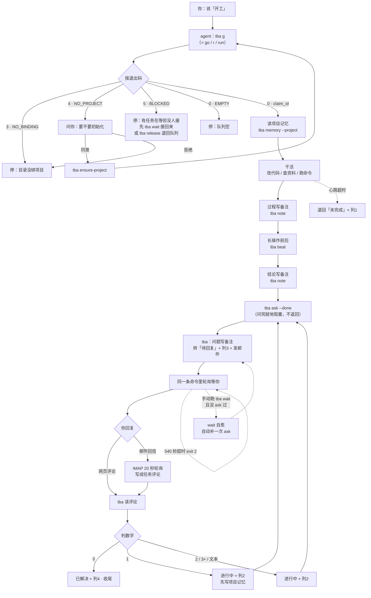
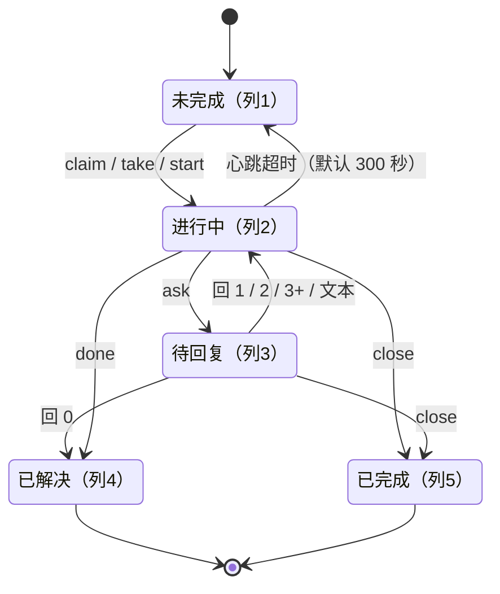
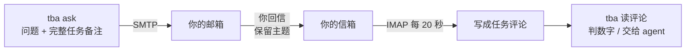

# TBA 任务流程

agent 只写任务备注 · 评论留给你 · 你回什么决定下一步。

## 一句话

```
你说「开工」→ tba g 领任务 → 读记忆 → 干活 → note 写备注
→ ask --done（转待回复 + 发邮件 + 就地阻塞等你）
→ 你在评论或邮件里回复 → 回 0 收尾，其他继续改
```

---

## 会话不许断

这是整套流程的第一约束，比「省 token」重要。

**原因**：WorkBuddy 的会话断了，要么你手动点，要么等一小时自动循环。所以 agent 不能自作主张结束会话——它必须一直挂着，直到你回数字。

**怎么做到**：`tba ask` 默认**问完就地阻塞**，不返回。agent 跑完这一条命令就卡在那里等，没有「问完忘了等」的中间态。

```
agent: tba ask <claim> --done
         ↓
       问题写备注 → 转「待回复」→ 发邮件 → 开始轮询
         ↓
       你回数字 → 命令返回 → 会话继续
       540 秒没回 → 退出码 2 → agent 改用 tba wait 接着等（不重跑 ask）
```

> 540 是默认值。单轮时长、评论轮询（15 秒）、邮件轮询（20 秒）都能改：
> `tba ui` →「⚙ 设置」→「等待与轮询」，或直接改 `data/config.toml`
> 的 `wait_timeout_secs` / `wait_interval_secs` / `mail_poll_secs`。
> `tba mail status` 最后一行回显当前生效值。

只有两种情况会结束：

| 情况 | 谁决定 |
|---|---|
| 你回了数字 | 你 |
| 你在网页上手动收尾（改状态 / 拖到列4-5） | 你（agent 收到退出码 3 才停） |

**agent 连 `ask` 都没跑就结束会话** → 300 秒后静默退回「未完成」+ 列1。不发邮件、不进「待回复」、`tba inbox` 看不到。这是故意的：没交付就不该占着任务，也不该拿一封假邮件打扰你。

**agent 把 `ask` 丢进后台** → 命令在后台跑着，会话却结束了，**没人接你的回复**。这是唯一能杀死这套流程的操作，所以有两道防线：

1. 文案里写死「`ask` 前台阻塞，禁止 `run_in_background`」。
2. 等待期间每 15 秒写一次 `data/waits/<claim>.wait`；进程被杀就停更，60 秒没刷新即判定「没人接了」。这时候 `tba inbox` 标 `⚠ 等待中断`，`tba g` / `tba claim` 返回 `BLOCKED`（退出码 5），先处理掉才能领新任务。

第 2 条是「禁止」的真正含义：挂后台不会立刻报错，但下次想干活会被拦住，必须回去把等待接上。

---

## 主流程



---

## 状态机



`kind` 分配：未完成 = `start`（全任务流唯一）、进行中 / 待回复 = `unset`、已解决 / 已完成 = `end`。
待回复是 `unset` 而不是 `end`——球在你那不等于干完了，否则完成率会虚高。

另有两个用途状态 `skill` / `mem`，不占阶段，`claim` 领不到。

---

## 命令

### 开工

| 命令 | 说明 |
|---|---|
| `tba g` | 一句话开工。**四个名字完全等价**：`g` / `go` / `r` / `run` |
| `tba go` | 同上 |
| `tba r` | 同上 |
| `tba run` | 同上 |

退出码：

| 输出 | 码 | 含义 | agent 动作 |
|---|---|---|---|
| `NO_BINDING <目录>` | 3 | 目录没绑项目，也不是 git 仓库 | 停。不领任务、不建项目 |
| `NO_PROJECT <id或名字>` | 4 | 绑定失效，或目录名在线上没匹配 | 问你要不要 `tba ensure-project` |
| `BLOCKED` | 5 | 手上有「在等回复但没人接」的任务 | 先 `tba wait` 接回来，或 `tba release` 退回 |
| `EMPTY <项目名>` | 0 | 队列空 | 停 |
| `claim_id: …` | 0 | 领到了 | 照输出干 |

### 干活

| 命令 | 说明 |
|---|---|
| `tba claim [--project <id>]` | 从「未完成」+ 列1 领最早一条 |
| `tba take <链接\|id>` | 接单：指定任务 → 进行中 + 列2 |
| `tba start [--project <id>] --file <md>` | 新建任务 → 进行中 + 列2 |
| `tba note <claim> --text "..."` | **追加到任务备注**（agent 唯一输出通道） |
| `tba beat <claim>` | 续命。长操作前后各一次 |
| `tba memory --project <id>` | 读项目记忆 |
| `tba memory --project <id> --append "..."` | 沉淀新坑 |

### 交回用户

| 命令 | 说明 |
|---|---|
| `tba ask <claim> --done` | **标准做法**。问题写备注 + 转「待回复」+ 列3 + 发邮件 + **就地阻塞等你** |
| `tba ask <claim> -q "..."` | 同上，但用你自定义的问题 |
| `tba ask <claim> --done --no-wait` | 只问不等，立刻返回。**一般不用**（会话会断） |
| `tba wait <claim>` | 单独等。ask 超时后重跑它，或只等外部收尾 |
| `tba inbox` | 列出所有待回复：谁在等、等了多久、问了什么 |

`ask` 的退出码：

| 码 | 含义 | agent 动作 |
|---|---|---|
| 0 | 收到回复，正文已打印 | 按 `action=` 走下一步 |
| 2 | 本轮 540 秒超时 | 改用 `tba wait <claim>` 接着等。**别重跑 `ask`**，会重发一次邮件 |
| 3 | 你在网页上手动收尾了 | 停 |

### 收尾

| 命令 | 说明 |
|---|---|
| `tba done <claim>` | 已解决 + 列4（只有你明确命令才跑） |
| `tba close <claim>` | 已完成 + 列5（作废） |
| `tba release <claim> --reason "..."` | 主动放弃：未完成 + 列1 |

---

## 回复方式

两条通道都行：**网页评论** 或 **直接回那封邮件**（保留主题）。

**数字最省事，但不是唯一写法。** 回文本完全可以，tba 判不了数字就原样交给 agent 理解。

| 你回什么 | tba 做什么 | 去哪 |
|---|---|---|
| `0` | 直接执行收尾 | 已解决 + 列4 |
| `1` | 直接执行，先写项目记忆 | 进行中 + 列2，写完再问 |
| `2` | 直接执行，agent 自查后重新给选项 | 进行中 + 列2 |
| `3+` | 直接执行，agent 自定义的选项 | 进行中 + 列2 |
| 一段文本 | 不判数字，**原样交给 agent** | 进行中 + 列2 |

只有 `0` 收尾。其余一律回「进行中」。

### 判数字的规则（避免歧义）

1. 首字符必须是 ASCII 数字，否则当文本（`好的，0` 不认）。
2. 数字后必须紧跟结尾或非 ASCII 字符（`0可以了` 认，`0abc` 不认）。
3. 去掉数字前缀后正文里还有数字 → 当文本（`1 和 2 都做了` 有歧义，不猜）。

---

## 两个通道

| 通道 | 谁写 | 内容 |
|---|---|---|
| **任务备注**（`note`） | 只有 agent | 过程、结论、提问。往后追加，带时间戳，不覆盖原始需求 |
| **任务评论** | 只有你 | 回数字、回文本、补说明。邮件回信也会被写成评论，落在这里 |

为什么这么分：

1. 一个 agent 一条任务，备注不存在多个 agent 并发覆盖的问题。
2. 评论里只有你的话，`wait` 不用再靠「内容是不是纯数字」去猜某条是谁发的。
3. 备注在网页任务详情第一屏可见，结论不会被评论淹没。

---

## 邮件链路



| 项 | 说明 |
|---|---|
| 什么时候发 | 只有 `ask` 发信。`mail_on_ask` 控制，默认开。`note` 不发 |
| 正文内容 | **问题 + 完整任务备注**。你在外面收信就能看到 agent 干了什么，不用跳回网页 |
| 主题标记 | `[TB clm-xxxx] 需要你回复：任务名`。**回信必须保留主题**，否则认不出是哪条任务 |
| 回信怎么进来 | `ask` 内置的等待每 20 秒轮询信箱，把回信**写成任务评论**，之后完全复用「读评论」逻辑 |
| 必须配 IMAP | SMTP 只能发，收不到回信。只配 SMTP 时邮件是单向通知，你回信没人读 |
| 发信失败 | 错误**写进任务备注**（`⚠ 邮件通知没发出去`），不再静默 |
| 重发 | `tba mail resend <claim_id>`：只重发通知，不动任务状态 |

回信写成评论，是为了让邮件和网页走同一条路——你在网页回 0、在邮件回 0，行为完全一样。

---

## 兜底

| 机制 | 行为 |
|---|---|
| **ask 就地阻塞** | 问完不返回，一直等到你回数字。这是会话不断的主机制 |
| **禁止丢后台** | 文案写死「`ask` 前台阻塞，禁止 `run_in_background`」。丢后台 = 命令在跑但会话结束了，没人接你的回复 |
| **等待中断检测** | `ask`/`wait` 每 15 秒写一次 `data/waits/<claim>.wait`。进程被杀就停更，60 秒没刷新即判定「没人接了」 |
| **阻断领新任务** | 有等待中断的任务时，`tba g` / `tba claim` 返回 `BLOCKED`（退出码 5），先处理掉才能领新的 |
| **ask 单轮超时** | 540 秒返回退出码 2，改用 `tba wait <claim>` 接着等（别重跑 `ask`，会重发信）。任务状态不变，会话不断 |
| **列1 强制重接** | 任务被拖到列1，不管台账里是 running / waiting / 什么状态，一律接管：旧 claim 标 `reverted`，新建一条。这是「断了怎么恢复」的答案——不依赖任何宿主能力，拖回去就行 |
| **待回复永不超时** | 挂在「待回复」的任务不参与心跳回收。放多久都安全 |
| **wait 自愈** | 手动跑 `tba wait` 而没 `ask` 过，tba 自动补一次：问题写备注 + 转「待回复」+ 发邮件。配置 `wait_auto_ask`（默认开）可关 |
| **发信失败可见** | 邮件没发出去会写进任务备注（`⚠ 邮件通知没发出去`），不再只打一行 stderr |
| **心跳超时退回** | 「进行中」超过 `heartbeat_timeout_secs`（默认 300 秒）没续命 → 退回「未完成」+ 列1。**这是故意的**：连 `ask` 都没跑就断了的会话，不该占着任务 |
| **退出码 3** | 任务在别处被收尾了（你手动改状态 / 拖到列4-5），agent 停止 |

---

## 配置项

都在 `data/config.toml`。

| 键 | 默认 | 说明 |
|---|---|---|
| `tasklist_queue` | `1` | 队列列号 |
| `tasklist_claim` | `2` | agent 干活列号 |
| `tasklist_wait` | `3` | 待回复列号 |
| `tasklist_done` | `4` | 已解决列号 |
| `tasklist_closed` | `5` | 已完成列号 |
| `heartbeat_timeout_secs` | `300` | 心跳超时（秒） |
| `mail_on_ask` | `true` | ask 时是否发邮件 |
| `wait_auto_ask` | `true` | wait 发现没 ask 过是否自动补 |
| `tool_path` | `tba` | 文案里的命令前缀 |
| `smtp_host` / `smtp_port` | — / `465` | 发信 |
| `smtp_user` / `smtp_pass` | — | 账号 + 授权码（不是登录密码） |
| `smtp_from` | — | 发件人。**留空 = 用 `smtp_user`**；也可写 `显示名 <邮箱>`。只写显示名会被拒（502） |
| `imap_host` / `imap_port` | — / `993` | 收信（不配就收不到回信） |
| `mail_to` | — | 收件人，多个用逗号或分号分隔 |

---

## 一句话记住

1. agent 只写备注，评论留给你。
2. 做完必须 `ask --done`，它自己会等你——**不许结束会话**。
3. 回 `0` 收尾，回别的继续改。
4. 「待回复」永不超时，慢慢回。
5. 连 `ask` 都没跑就断了 → 静默回列1，不打扰你。
